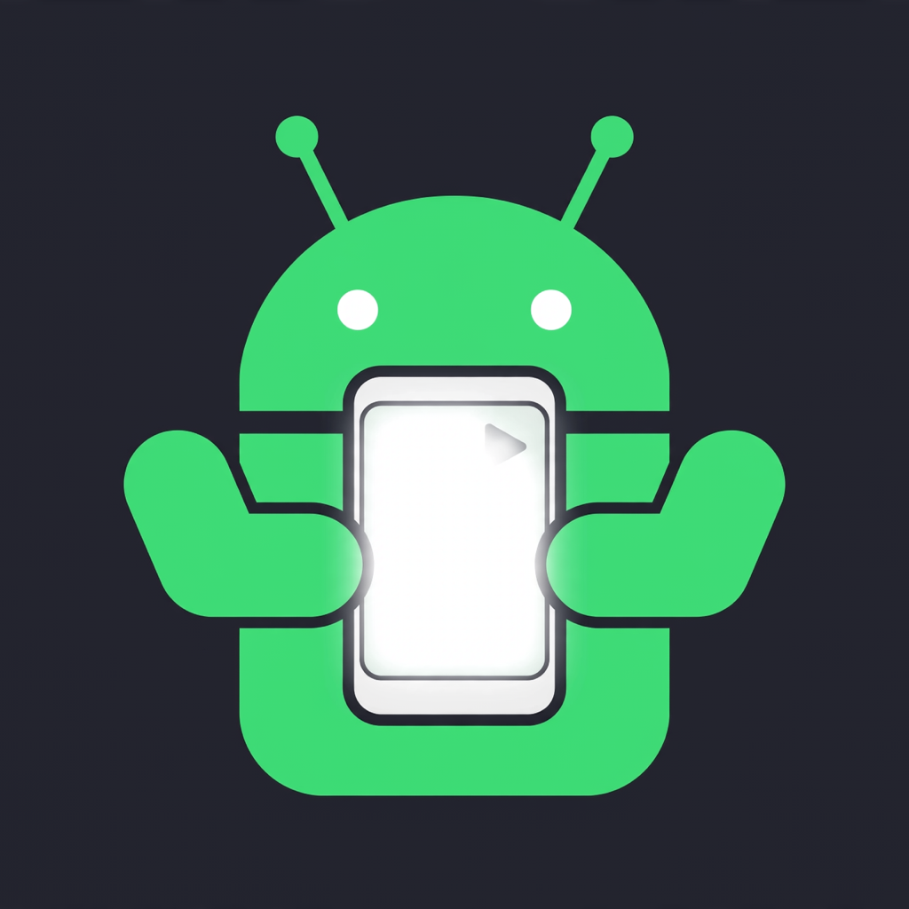

<p align="center">
  
</p>

# ANDROID SCREEN MIRROR INSIDE MAC WITH CONTROL

[](https://github.com/vernanng/screengood/actions/workflows/ci.yml)
[](https://github.com/vernanng/screengood/releases/latest)

**Wi-Fi or USB-C.**

See your Android phone inside a window on your Mac and control the entire
phone with your Mac mouse — every app, every screen — without touching the
phone:

**click: tap · mouse scroll: up/down · onscreen scroll · offscreen scroll
with SHIFT+SCROLL**

One Rust binary does the work. It finds the phone, opens the mirror with
[`scrcpy`](https://github.com/Genymobile/scrcpy), and turns mouse-wheel moves
into precise up/down phone swipes over
[`adb`](https://developer.android.com/tools/adb), so scrolling behaves the
same inside any app. Tuned on a Samsung S25 FE, including while the same
phone is also mirrored to an external monitor.

**At a glance:** Apple Silicon Mac (M-series), macOS 13+ · Android phone
with USB debugging or Wireless debugging · [Homebrew](https://brew.sh)
(only so the app can auto-install `adb` and `scrcpy` if missing).

Contents: [Download](#download) · [Quick start](#quick-start) ·
[Wi-Fi or USB-C](#wi-fi-or-usb-c) · [Controls](#controls) ·
[Settings](#settings) · [One-time setup](#one-time-setup) · [Build from source](#build-from-source) ·
[Commands](#commands) · [How it works](#how-it-works) ·
[Troubleshooting](#troubleshooting) · [Uninstall](#uninstall)

## Download

Two ways to get the app:

**Cargo install (free, no Gatekeeper warning):**

Copy-paste install for macOS 13+ (installs Rust itself if missing; safe
to run even if you already have it):

```sh
curl https://sh.rustup.rs -sSf | sh
source "$HOME/.cargo/env"
cargo install --git https://github.com/vernanng/screengood --locked
screengood install
open /Applications/ScreenGood.app
```

`screengood install` builds the same double-clickable `ScreenGood.app`
(with its icon) into `/Applications` — or into `~/Applications` when the
system folder is not writable. Because the app is compiled on your Mac,
macOS never quarantines it: no “Apple could not verify” dialog at all.
Do the [one-time setup](#one-time-setup) below once for your build, then
just double-click the app from then on.

**ZIP download (no Rust needed):**

Grab the latest build from
[Releases](https://github.com/vernanng/screengood/releases) (a `.zip` of the
native macOS app):

1. Download `ScreenGood-vX.Y.Z-macOS-arm64.zip`, unzip it, and move
   **ScreenGood.app** to `/Applications`.
2. Allow the first launch (next section). This build is ad-hoc signed, not
   notarized, so macOS blocks the first open of the downloaded copy.
3. Do the [one-time setup](#one-time-setup) below, then just double-click
   the app from then on.

### First launch: “Apple could not verify ScreenGood.app …”

This warning is expected for the GitHub download. It does not mean malware
was found. It means the app has no Apple Developer ID signature and no
notarization, so macOS cannot verify the publisher. Removing the warning
for everyone would require an Apple Developer ID and notarization. This
project deliberately ships the download ad-hoc signed instead (no Apple Developer ID). Building locally avoids this warning entirely — see the Cargo install option above.

Allow this one copy, once, either way:

**Settings (recommended)**

1. Double-click **ScreenGood** in `/Applications`. Close the warning with
   **Done**. Do not choose **Move to Trash**.
2. Open **Settings → Privacy & Security**. Scroll to the **Security**
   section near the bottom.
3. Next to the message saying ScreenGood was blocked, click **Open
   Anyway**. Confirm **Open Anyway** again and authenticate if asked.
4. ScreenGood launches. Later double-clicks open normally.

Older advice to right-click → **Open** no longer bypasses this dialog on
current macOS, so use **Open Anyway** above.

**Terminal (alternative)**

Copy the app to `/Applications` first, then remove the download-quarantine
flag from that copy:

```sh
xattr -dr com.apple.quarantine /Applications/ScreenGood.app
open /Applications/ScreenGood.app
```

Prefer building from source? See
[Build from source](#build-from-source).

## Quick start

1. Connect the phone by USB-C, or put phone and Mac on the same Wi-Fi with
   Wireless debugging on.
2. Double-click **ScreenGood.app**.
3. The phone screen appears in a Mac window. Control it with the mouse.

USB-C is picked automatically whenever a cable-connected phone is available.
Without a cable, the app tries the last saved Wi-Fi address, then searches the
local network (mDNS `_adb-tls-connect`) and saves the address it finds.

## Wi-Fi or USB-C

| Connection | Experience | Mirror profile |
|---|---|---|
| **USB-C** | Preferred. Near-zero delay and the steadiest control. | `--max-size 1440` (664×1440 on the S25 FE), H.265, 12 Mbps, up to 60 fps, 0 ms video buffer, 30 ms raw-audio buffer, Metal renderer |
| **Wi-Fi** | No cable. Extra buffering absorbs network jitter. | `--max-size 900` (414×900), 100 ms video buffer, 100 ms audio buffer |

The frame is intentionally smaller than the phone's native 1080×2340 screen
to keep encoding and decoding delay low. On the S25 FE, the hardware HEVC
encoder held 59–61 fps at the USB profile even while another encode was
running (mirroring out to a monitor at the same time).

## Controls

| Input | Action on the phone |
|---|---|
| **Click** (inside the mirror) | Tap |
| **Drag** (inside the mirror) | Swipe |
| **Right-click** (inside the mirror) | Android Back |
| **Onscreen scroll** — plain wheel, mouse on the mirror | Scroll down / up (NEXT / PREV) |
| **Offscreen scroll — SHIFT + SCROLL**, mouse anywhere else | Scroll down / up (NEXT / PREV) |
| **SHIFT + middle-click** or **SHIFT + right-click**, away from the mirror | Tap screen center (pause/resume in video players) |

Onscreen scroll and offscreen SHIFT+SCROLL are one and the same function:
wheel movement is accumulated in light-scroll steps and fired as one tuned
**400 ms swipe** per step (`SHIFT+wheel` is the reference behaviour; the
on-screen wheel was made to match it exactly). This works in any app, not
just one feed or player.

Clicks on the mirror itself always belong to `scrcpy`; the extra listener
deliberately steps aside there so one click can never land as a double tap.

Watching on a monitor is optional and independent: mirror the phone to
your monitor separately (wireless display or cable) if you want the same
screen there while you control it from the Mac.

## Settings

Scroll feel is adjustable in a small native window.
While mirroring, click the floating gear **Settings** tab on the
left edge of the mirror window.
It sticks to the window as it moves, and the whole title bar stays
free, so the window is still easy to drag.
The mirror's main window title is just **ScreenGood**.

The same window can also be opened from Terminal:

```sh
./target/release/screengood settings
```

For an installed app without a mirror running, the Terminal form is
`/Applications/ScreenGood.app/Contents/MacOS/screengood settings`.

Three sliders:

- **Scroll step** — wheel movement per up/down step. Lower is more
  sensitive.
- **Cooldown** — pause between steps. Higher means fewer accidental
  double steps.
- **Swipe duration** — phone swipe time per step, in milliseconds.

**Save** writes `~/Library/Application Support/ScreenGood/settings.txt`.
Changes apply on next launch, so reopen ScreenGood to use them.
Each launch logs its effective values as `Scroll settings: ...`.
**Defaults** restores step 6 px, cooldown 900 ms, swipe 400 ms.
Deleting the settings file does the same.

The window needs no phone. It can be opened while mirroring; the
floating Settings button follows the mirror window and disappears in
fullscreen or when the mirror closes.
Only scroll feel is adjustable; the mirror profiles above stay fixed.
`SCREENGOOD_SETTINGS` overrides the settings file path.

## One-time setup

### Android

For USB-C:

1. Enable Developer options.
2. Enable **USB debugging**.
3. Connect with a data-capable USB-C cable.
4. Unlock the phone and accept the USB-debugging prompt if shown.

For Wi-Fi:

1. Put the phone and Mac on the same Wi-Fi network.
2. Enable Developer options.
3. Enable **Wireless debugging**.
4. Keep the phone screen on for the first connection.

For monitor viewing, mirror the phone to the monitor (wireless display or cable).

### Mac permissions

The wheel listener needs ScreenGood allowed in both of these:

- **Settings → Privacy & Security → Input Monitoring**
- **Settings → Privacy & Security → Accessibility**

Every launch **checks first — before the phone connects**. The app
silently preflights both permissions, so a missing grant prompts
immediately instead of mid-launch:

- **Both granted** → no dialog, no Settings window, the mirror just opens.
  Ordinary launches never ask again.
- **One missing** → only that one is requested. The app registers itself in
  just that list (no `+` button or file picker needed) and opens just that
  pane. Switch ScreenGood **on** there, then reopen the app. macOS does not
  let any app flip its own security switch, so that click is yours — once.

The mirror itself (click/tap/drag through `scrcpy`) works even without these
grants; only the wheel NEXT/PREV controls need them.

Two things worth knowing:

- By default the app is ad-hoc signed, so macOS ties grants to the exact
  build. A *downloaded release never rebuilds*, so this is a one-time
  setup there. If you rebuild from source with `make-app`, grant both
  permissions once more for the new build — **unless** you do the
  one-time stable-signing setup below.
- **Never re-grant after rebuilds (recommended for source installs):** run
  once, in a terminal:

  ```sh
  screengood setup-signing
  ```

  This creates a free self-signed identity (“ScreenGood Local Signing”)
  in a dedicated keychain file under
  `~/Library/Application Support/ScreenGood/` — your login keychain is
  never used. macOS asks for your login password once to trust the
  certificate; type it and allow. From then on every `make-app` /
  `install` build is signed with that identity, so the permission grants
  survive every rebuild. Grant both permissions one last time after
  installing the stable-signed build, then never again.
  To undo: first remove the trust entry with
  `security remove-trusted-cert ~/Library/Application\ Support/ScreenGood/signing-cert.pem`,
  then delete the support folder. Later ad-hoc builds need fresh grants
  again.
- After a rebuild the Settings rows can show **on** yet not take effect
  (the saved grant belongs to the previous build's code hash). Fix it by
  clearing the stale entries, then reopening the app so it re-registers:

  ```sh
  tccutil reset Accessibility com.screengood.app
  tccutil reset ListenEvent com.screengood.app
  ```

Each launch logs its preflight result (and any `scrcpy` output) to
`~/Library/Logs/ScreenGood.log` — Finder launches have no terminal, so that
file is the first place to look when something seems off.

### Tools

`adb` and `scrcpy` stay external. If they are missing, the app installs the
Homebrew packages `android-platform-tools` and `scrcpy` automatically
([Homebrew](https://brew.sh) itself must be installed). No Python is needed
at runtime.

## Build from source

Requires a Rust toolchain (pinned by `rust-toolchain.toml`: stable with
`rustfmt` and `clippy`) and macOS 13+.

```sh
cargo build --release
./target/release/screengood make-app   # assembles + signs ScreenGood.app
open ScreenGood.app
```

Terminal alternative (no app bundle):

```sh
./target/release/screengood            # mirror mode is the default
```

Package the native macOS app the same way CI does (ZIP only):

```sh
ditto -c -k --sequesterRsrc --keepParent ScreenGood.app ScreenGood-macOS-arm64.zip
```

## Commands

```sh
./target/release/screengood              # mirror on the Mac (default)
./target/release/screengood mirror       # same, explicit
./target/release/screengood listen       # wheel/click listener only, no mirror window
./target/release/screengood settings     # scroll-feel Settings window (applies on next launch)
./target/release/screengood test         # built-in selftest; no phone needed
./target/release/screengood wheel-probe  # 20 s raw wheel/click event log (diagnostics)
./target/release/screengood click-probe  # click-focused probe alias
./target/release/screengood make-app     # assemble + sign ScreenGood.app
./target/release/screengood install      # install the app bundle into /Applications (or ~/Applications)
./target/release/screengood setup-signing # one-time stable local signing (grants survive rebuilds)
```

Tests and checks (no phone needed):

```sh
cargo test                                         # 46 unit tests
cargo clippy --all-targets --locked -- -D warnings # same lint CI runs
cargo fmt --check
./target/release/screengood test  # prints SELFTEST OK - DOWN=NEXT, UP=PREV
```

`make-app` and `install` sign with the `setup-signing` local identity
when it exists (identifier `com.screengood.app`), otherwise ad hoc
(`codesign --sign -`), and bundle `assets/AppIcon.icns` when present.
The plist version always follows
`Cargo.toml` (`env!("CARGO_PKG_VERSION")`), so only one place sets the
version.

## How it works

`screengood` is a single Cargo binary (Rust 2021). It coordinates `adb` and
`scrcpy`; it does not replace them.

| File | Role |
|---|---|
| `src/main.rs` | Commands and app flow: mirror profiles and the ScreenGood main window title, permission check-then-request, single-instance replacement, GUI log redirect, `settings`/title-bar dispatch, `make-app`/`install`/`setup-signing`, selftest |
| `src/discover.rs` | Phone discovery: USB-first, saved Wi-Fi address (`phone-ip.txt`), mDNS `_adb-tls-connect._tcp.local.`, real screen size via `wm size` |
| `src/listener.rs` | Direct `CGEventTap` (via `core-graphics`): wheel/click handling, mirror-window detection, consumed-event suppression, tap auto-recovery, permission preflight/request |
| `src/logic.rs` | Pure decisions: NEXT/PREV mapping, light-scroll pixel accumulation (6 px default step), 900 ms default cooldown, swipe geometry, 400 ms default swipe duration |
| `src/settings.rs` | Scroll-feel settings file: step/cooldown/swipe values, forgiving parse + clamp, loaded once at launch |
| `src/settings_window.rs` | Native AppKit Settings window (`objc2`): three sliders, Save applies on next launch |
| `src/title_bar.rs` | Floating gear Settings tab on the mirror's left edge: sticks to the scrcpy window via Accessibility move/resize events (poll fallback) |
| `src/adb.rs` | Pinned-serial `adb -s <serial> shell input` commands with a 5 s timeout |
| `assets/` | App icon: `icon-1024.png` master + `AppIcon.icns` (made with `sips` + `iconutil`) |

A few behaviours exist because of hard-won macOS facts:

- **Finder has no Homebrew in `PATH`.** A double-clicked app inherits a
  minimal GUI `PATH`, and `scrcpy` spawns `adb` by bare name — that used to
  make double-clicks silently do nothing. `screengood` now passes `scrcpy`
  the absolute `adb` path via the `ADB` environment variable (plus a
  Homebrew-prefixed `PATH`).
- **One mirror at a time.** Launching while a mirror is running replaces the
  old instance instead of two processes fighting over the phone's one
  screen capture.
- **Check before asking.** Permissions are preflighted silently on every
  launch; see [Mac permissions](#mac-permissions).

Design history (the Rust stack switch, decisions, and parity checks) is in
[`docs/plans/2026-10-25-rust-stack-switch.md`](docs/plans/2026-10-25-rust-stack-switch.md).

Local-only files, never committed: `phone-ip.txt` (saved Wi-Fi address),
`ScreenGood.app` and `target/` (build outputs).

## Troubleshooting

**“Apple could not verify ScreenGood.app is free of malware …”**

The downloaded build is ad-hoc signed and not notarized. Follow the
one-time **Open Anyway** steps under [Download](#download). Do not
choose **Move to Trash**. The alternative Terminal fix there is
`xattr -dr com.apple.quarantine /Applications/ScreenGood.app`.

**Double-click does nothing**

`ScreenGood.app` has no window of its own — look for the separate `scrcpy`
mirror window, which can open behind other apps. Then read
`~/Library/Logs/ScreenGood.log`; every GUI launch and its `scrcpy` output
land there. If a permission is missing, System Settings opens instead (see
[Mac permissions](#mac-permissions)).

**Settings shows ScreenGood on, but it still asks**

The grant is stale: it was saved for a previous build's code hash. Run the
two `tccutil reset` commands in [Mac permissions](#mac-permissions), reopen
the app, and toggle on once for the current build.

**SHIFT+wheel does nothing**

Confirm both Input Monitoring and Accessibility are on for
`ScreenGood.app`, then reopen the app (grants apply to new launches). The
log's preflight line tells you exactly which one macOS still reports as
missing. `./target/release/screengood wheel-probe` shows whether wheel
events reach the listener at all.

**Phone not found on Wi-Fi**

Wireless debugging rotates its port. Keep Wireless debugging on; from a
terminal run, press ENTER at the retry prompt. The app searches by mDNS and
saves the new address to `phone-ip.txt` when it connects.

**USB-C phone is not detected**

Unlock the phone, confirm USB debugging is on, accept the computer prompt
on the phone, and use a data-capable cable rather than a charge-only one.

**Center-tap (pause) fires twice**

Clicks over the mirror are intentionally left to `scrcpy`. If a
SHIFT+click still double-fires, the mirror window was probably
misdetected — bring the mirror to the front and try again.

**Two phone entries in `adb devices`**

An IP entry plus an mDNS (`_tcp`) entry for one phone is normal. The app
pins one serial for every `adb` command, so input cannot split across
transports.

## Uninstall

1. Delete `/Applications/ScreenGood.app`.
2. Optionally remove its permission entries and local files:

   ```sh
   tccutil reset Accessibility com.screengood.app
   tccutil reset ListenEvent com.screengood.app
   rm -f ~/Library/Logs/ScreenGood.log
   ```

3. If you ran `screengood setup-signing`, also remove its material:

   ```sh
   security remove-trusted-cert ~/Library/Application\ Support/ScreenGood/signing-cert.pem
   rm -rf ~/Library/Application\ Support/ScreenGood
   ```

4. If you installed via Cargo, `cargo uninstall screengood` removes the
   command-line binary.

5. From a source checkout, `phone-ip.txt`, `ScreenGood.app`, and `target/`
   in the project folder can also be deleted. `adb`/`scrcpy` themselves
   are Homebrew packages — remove with `brew uninstall scrcpy
   android-platform-tools` only if nothing else needs them.

